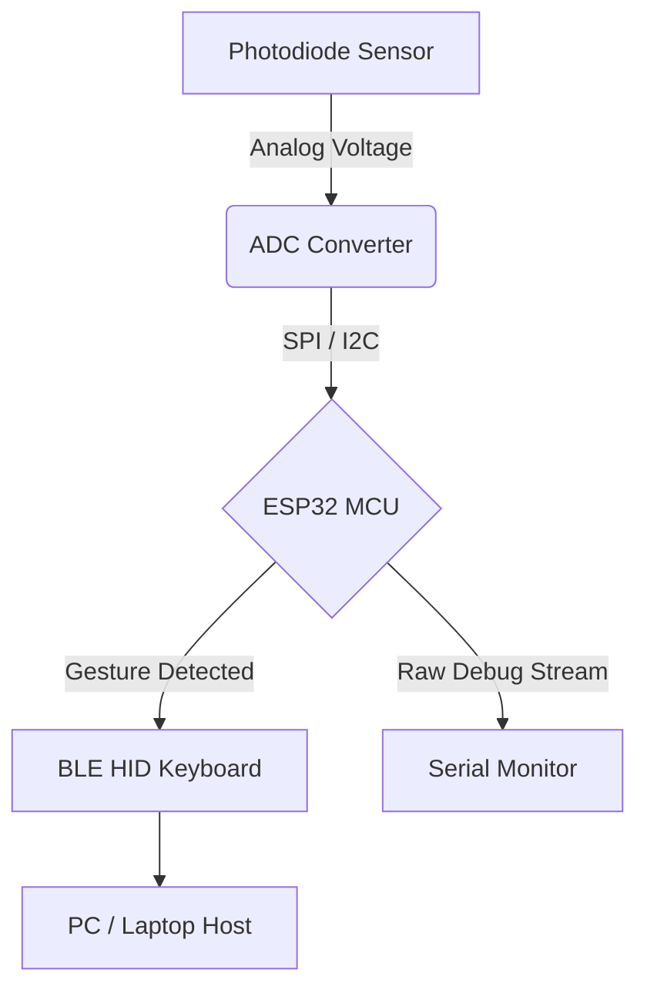

# September 20: Typography, Headings and Text Styles
Here is a paragraph of standard body text. It uses **Inter** at 16px with a line-height of 1.5. This paragraph demonstrates *italic emphasis*, **bold text**, ***bold and italic***, ~~strikethrough~~, and `inline code snippet`.

Escaped characters like \*literal asterisks\* and \_underscores\_ render as literal characters without formatting. Subscript H~2~O and superscript X^2^ are also supported.

Here is a paragraph with [an internal anchor link](#tables-and-task-lists) and [an external link to GitHub](https://github.com) which opens in a new tab with `rel="noopener noreferrer"`. Bare URLs like https://ayysappling.com autolink directly.

Emoji shortcodes are parsed via gemoji: :tada: :rocket: :sparkles: :memo: :white_check_mark:.

## Heading Level 2 with border bottom
Headings inside an entry start at h2. Notice the border-bottom and padding. Hover over to see the anchor link icon.

### Heading Level 3 (Sub-section)
Notice the sizing of h3 (1.25em).

#### Heading Level 4
Heading 4 is 1em with font weight 600.

##### Heading Level 5
Heading 5 is 0.875em.

###### Heading Level 6
Heading 6 is 0.85em with secondary text color.

**Total time spent: 1.5 hours**

# September 21: GitHub Alerts and Callouts
GitHub alerts use blockquote syntax with custom icons and left borders.

> [!NOTE]
> Useful information that users should know, even when skimming.

> [!TIP]
> Helpful advice for doing things better or more easily.

> [!IMPORTANT]
> Key information users need to know to achieve their goal.

> [!WARNING]
> Urgent info that needs immediate user attention to avoid problems.

> [!CAUTION]
> Advises about risks or negative outcomes of certain actions.

Standard blockquote (not an alert):
> This is a regular multi-line blockquote.
> It has a left border with border-hover color and secondary text color.
> GitHub blockquotes are NOT italicized.
>
> > Nested blockquotes are also supported and render cleanly.

**Total time spent: 0.8 hours**

# September 22: Lists, Task Lists, Details and Kbd
Here are different types of lists and collapsible widgets.

### Unordered Lists (Nested)
- Level 1 item with disc marker
  - Level 2 nested item with circle marker
    - Level 3 deeply nested item with square marker
- Another level 1 item
- Next sibling item with proper top margin

### Ordered Lists
1. First ordered step
2. Second ordered step
3. Third ordered step

### Task Lists (GFM)
- [x] Completed task item (checked and disabled)
- [ ] Incomplete task item (unchecked and disabled)
- [x] Final review of schematics and BOM

### Keyboard Input (`<kbd>`)
Press <kbd>Ctrl</kbd> + <kbd>C</kbd> to copy, or <kbd>Esc</kbd> to close the image lightbox modal. Press <kbd>Cmd</kbd> + <kbd>K</kbd> to search.

### Collapsible Details (`<details>` / `<summary>`)
<details>
<summary>Click to view hardware pinout configuration</summary>

Here is the secret configuration details inside:
- Pin GPIO 4: I2C SDA
- Pin GPIO 5: I2C SCL
- Pin GPIO 18: SPI SCK
- Pin GPIO 19: SPI MISO
- Pin GPIO 23: SPI MOSI

```json
{
  "baudRate": 115200,
  "sensorMode": "gesture_continuous",
  "irThreshold": 450
}
```
</details>

**Total time spent: 1.2 hours**

# September 23: Tables and Task Lists
Here is a table testing alignment, padding, borders, and alternating row backgrounds.

| Feature | Supported | Description | Alignment |
| :--- | :---: | ---: | :--- |
| GFM Tables | Yes | Formatted with border tokens | Left |
| Center Align | Yes | Centered text content | Center |
| Right Align | Yes | Numerical amounts or stats | Right |
| Alternating Rows | Yes | Even rows get inline code tint | Left |
| Responsive Scroll | Yes | Table containers scroll on overflow | Left |

Here is a footnote reference test[^1] and a second footnote reference[^note2].

[^1]: This is the first footnote at the bottom of the entry with a back-link arrow.
[^note2]: Footnotes are styled in 12px font with a border-top separator.

**Total time spent: 0.5 hours**

# September 24: Code Blocks and Syntax Highlighting
Testing Shiki dual-theme syntax highlighting for Python, C++, JSON, Bash, YAML, and Diff.

### Python Code Block
```python
import math

class GestureController:
    """Handles gesture recognition from IR photodiode array."""
    def __init__(self, threshold: float = 0.75):
        self.threshold = threshold
        self.active_gestures = []

    def process_vector(self, x: float, y: float, z: float) -> str:
        magnitude = math.sqrt(x**2 + y**2 + z**2)
        if magnitude > self.threshold:
            return "SWIPE_DETECTED"
        return "IDLE"
```

### C++ Code Block
```cpp
#include <iostream>
#include <vector>

int main() {
    std::vector<int> sensor_readings = {120, 245, 890, 430};
    for (const auto& val : sensor_readings) {
        if (val > 500) {
            std::cout << "Threshold exceeded: " << val << std::endl;
        }
    }
    return 0;
}
```

### Diff Code Block
```diff
--- a/firmware/main.cpp
+++ b/firmware/main.cpp
@@ -10,4 +10,4 @@
-int sampleRate = 50;
+int sampleRate = 100;
-bool debugMode = false;
+bool debugMode = true;
```

### JSON and Bash
```json
{
  "project": "gemote",
  "version": "1.0.0",
  "sensors": ["APDS-9960", "MPU-6050"]
}
```

```bash
# Flash ESP32 firmware
esptool.py --chip esp32 --port /dev/ttyUSB0 write_flash 0x10000 firmware.bin
```

**Total time spent: 2.0 hours**

# September 25: Math and LaTeX Rendering
Inline math equation: $E = mc^2$ and $\sqrt{x^2 + y^2}$.

Block display equation:
$$
\int_{-\infty}^{\infty} e^{-x^2} dx = \sqrt{\pi}
$$

Matrix equation:
$$
\mathbf{R}(\theta) = \begin{pmatrix} \cos\theta & -\sin\theta \\ \sin\theta & \cos\theta \end{pmatrix}
$$

**Total time spent: 1.0 hours**

# September 26: Mermaid Diagrams
Fenced mermaid block should render client-side with dynamic theme support:



**Total time spent: 0.7 hours**

# September 27: Relative Path Asset Resolution and Lightbox
Testing relative paths against the project repo:
- Relative image path: `JOURNAL_ASSETS/journal1_image1.png`
- Relative schematic path: `Schematic/GEMOTE.svg`
- Link to firmware file: [gesture_driver.cpp](firmware/gesture_driver.cpp)


An image with the default placeholder "alt text" should NOT render a caption:


**Total time spent: 0.4 hours**
